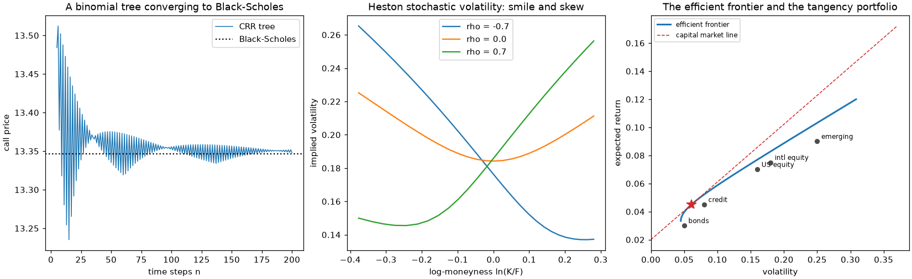

financialkit: Quantitative Finance in Python
============================================

.. include:: /_generated/vars.rst

**financialkit** is a unified toolkit for quantitative finance, spanning
|num_subpackages| domains, from the time value of money and fixed income
to stochastic volatility, credit and market microstructure, under one
NumPy-based API. It's built for finance students working through a
textbook problem, curious learners exploring a model on their own, and
educators building a demonstration. Under the hood, it calls
`numpy`/`scipy` directly for anything they already implement
(distributions, root finding, optimization and linear programming,
quadrature, FFTs, quasi-random sequences, sparse solvers, matrix
exponentials, and more). financialkit's value-add is its own
dataclass-result API, docstrings, visualizers, tests, and examples wrapped
around those calls, not reinventing numerical primitives that are already
correct and well-tested upstream. Algorithms are hand-written only where
no `numpy`/`scipy` equivalent exists (binomial and trinomial trees,
Longstaff-Schwartz, curve bootstrapping, PSOR, the ARMA and GARCH
likelihoods, the ADF test with MacKinnon critical values, Ledoit-Wolf
shrinkage), or where the iteration itself is the lesson. There is no
dependency on pandas, statsmodels, arch or QuantLib, and nothing touches
the network: every example runs on seeded synthetic data.

Every subpackage is grounded in the finance it implements, not just
coded against it: public functions carry runnable, CI-checked examples,
and each subpackage's :doc:`history </history/index>` page traces the
breakthroughs behind it, from Fibonacci's present values to the CAPM,
Black-Scholes and Heston, each one linked to the code that reproduces it.

In short, financialkit is |num_subpackages| domains behind one
consistent API, plus a history-of-finance narrative in which every
milestone links to runnable gallery code. It is closest in spirit to a
textbook such as Hull's *Options, Futures, and Other Derivatives* or
Glasserman's *Monte Carlo Methods in Financial Engineering*, but packaged
as an importable library.

.. important::

   financialkit is educational and research software, **not investment
   advice**. It is not a production pricing, trading or risk system, and
   nothing in it should be relied on for trading, valuation or regulatory
   decisions. Each domain is a teaching-depth subset of its field; for
   production work, use dedicated tools (for example
   `QuantLib <https://www.quantlib.org/>`__,
   `statsmodels <https://www.statsmodels.org/>`__,
   `arch <https://arch.readthedocs.io/>`__ or
   `CVXPY <https://www.cvxpy.org/>`__) directly.

**Foundations**

- :mod:`financialkit.time_value` -- compounding and equivalent rates,
  present value and NPV, annuities, IRR and MIRR, amortization and the
  APR, and day-count conventions.

  .. image:: _static/images/readme_time_value.png
     :alt: Compounding toward e, an NPV profile with two IRRs, and a mortgage amortization schedule
     :width: 100%

- :mod:`financialkit.fixed_income` -- bond prices and yields, durations
  and convexity, bootstrapped, spline, Nelson-Siegel and Svensson curves,
  immunization, and swaps.

  .. image:: _static/images/readme_fixed_income.png
     :alt: The price-yield curve of a bond, a Nelson-Siegel zero curve, and yield-curve principal components
     :width: 100%

**Derivatives**

- :mod:`financialkit.options` -- Bachelier, Black-Scholes-Merton, Black-76
  and Garman-Kohlhagen, parity and bounds, the Greeks and delta hedging,
  implied volatility and the smile, and binomial and trinomial trees.

  .. image:: _static/images/readme_options.png
     :alt: Black-Scholes call values, the Greeks of a call, and implied volatility smiles
     :width: 100%

- :mod:`financialkit.exotic_options` -- barriers, binaries, Asians,
  lookbacks, variance swaps, compounds, choosers, Margrabe, Stulz and
  quanto options, and Longstaff-Schwartz.

  .. image:: _static/images/readme_exotic_options.png
     :alt: GBM paths knocked out by a double barrier, Merton's down-and-out call, and the Longstaff-Schwartz exercise boundary
     :width: 100%

- :mod:`financialkit.stochastic_volatility` -- local volatility, Heston,
  jumps and variance gamma, Fourier pricing, SABR and SVI, and Heston
  simulation.

  .. image:: _static/images/readme_stochastic_volatility.png
     :alt: Heston volatility paths, Heston smiles by vol of vol, and Dupire local volatility
     :width: 100%

**Numerical Methods**

- :mod:`financialkit.monte_carlo` -- crude Monte Carlo with error bars,
  variance reduction, quasi-Monte Carlo, Monte Carlo Greeks, and
  multilevel Monte Carlo.

  .. image:: _static/images/readme_monte_carlo.png
     :alt: Sobol points, quasi-Monte Carlo error convergence, and Monte Carlo option prices with error bars
     :width: 100%

- :mod:`financialkit.pde_methods` -- explicit, implicit and
  Crank-Nicolson schemes, stability analysis, American options by PSOR,
  and two-factor ADI.

  .. image:: _static/images/readme_pde_methods.png
     :alt: A Crank-Nicolson value surface, von Neumann amplification factors, and the PSOR exercise boundary
     :width: 100%

**Rates & Credit**

- :mod:`financialkit.interest_rate_models` -- Vasicek, CIR and affine
  short rates, Ho-Lee, Hull-White, G2++ and Black-Derman-Toy, bond options,
  caps and swaptions, and HJM.

  .. image:: _static/images/readme_interest_rate_models.png
     :alt: Vasicek yield curves, mean-reverting short-rate paths, and a Black-Derman-Toy tree
     :width: 100%

- :mod:`financialkit.credit` -- structural models and distance to
  default, hazard curves and CDS, rating migrations, portfolio credit
  loss, the Basel IRB formula, and CDO tranches.

  .. image:: _static/images/readme_credit.png
     :alt: A survival curve bootstrapped from CDS spreads, a CreditRisk+ loss distribution, and a rating transition matrix
     :width: 100%

**Portfolios & Asset Pricing**

- :mod:`financialkit.portfolio` -- mean-variance frontiers, Kelly and
  Merton, CPPI, covariance shrinkage, Black-Litterman, CVaR optimization,
  risk parity and HRP, and performance ratios.

  .. image:: _static/images/readme_portfolio.png
     :alt: Risk-parity weights, the most diversified portfolio, and CPPI wealth paths
     :width: 100%

- :mod:`financialkit.asset_pricing` -- dividend discount models, the
  CAPM and its tests, factor models and the APT, the consumption CAPM and
  the equity premium puzzle, and the Hansen-Jagannathan bound.

  .. image:: _static/images/readme_asset_pricing.png
     :alt: The security market line, the Hansen-Jagannathan bound, and Shiller's excess volatility
     :width: 100%

**Risk & Markets**

- :mod:`financialkit.risk` -- VaR in all its flavours, expected
  shortfall, extreme value theory, backtests, copulas, and drawdowns.

  .. image:: _static/images/readme_risk.png
     :alt: Monte Carlo VaR of a straddle book, a VaR backtest, and a t copula
     :width: 100%

- :mod:`financialkit.time_series` -- stylized facts, random-walk tests,
  ARMA, unit roots and cointegration, the Hurst exponent, the GARCH
  family, and realized volatility.

  .. image:: _static/images/readme_time_series.png
     :alt: Power-law tails of returns, GARCH conditional volatility, and the autocorrelation of squared returns
     :width: 100%

- :mod:`financialkit.market_microstructure` -- spreads and their
  estimators, trade classification, dealer models, Kyle and
  Glosten-Milgrom, PIN and VPIN, price impact, and optimal execution.

  .. image:: _static/images/readme_market_microstructure.png
     :alt: Almgren-Chriss liquidation trajectories, Glosten-Milgrom quotes, and Avellaneda-Stoikov market making
     :width: 100%

**financialkit** is part of a family of packages, with
`mathematicskit <https://cpoli.github.io/mathematicskit/>`_,
`physicskit <https://cpoli.github.io/physicskit/>`_ and
`chemistrykit <https://cpoli.github.io/chemistrykit/>`_, that share the
same architecture, API conventions, and history-driven documentation.

Install and try it
------------------

.. code-block:: bash

   pip install "financialkit[fast]"   # with numba JIT acceleration (recommended)
   pip install financialkit           # pure numpy/scipy/matplotlib, e.g. for Pyodide

The ``fast`` extra adds `numba <https://numba.pydata.org/>`_, which compiles
the inner loops of ``integrators``, ``options``, ``interest_rate_models``,
``monte_carlo``, ``pde_methods`` and ``stochastic_volatility``. Without it,
those kernels run as plain Python with the same results, only slower.

To try it without installing anything, open the
`quickstart notebook <https://colab.research.google.com/github/cpoli/financialkit/blob/main/notebooks/quickstart.ipynb>`__
in Colab or `in JupyterLite <lite/lab/index.html?path=quickstart.ipynb>`__,
or use the **JupyterLite** button at the top of every gallery example. Every gallery also has a download-all
button for its scripts and notebooks. The public API follows a documented
`stability and deprecation policy <https://github.com/cpoli/financialkit/blob/main/CONTRIBUTING.md#api-stability-and-deprecation-policy>`__.

Five tutorials follow one problem across several domains:
:doc:`/tutorials/one_option_five_pricers`,
:doc:`/tutorials/yield_curve_end_to_end`,
:doc:`/tutorials/where_the_smile_comes_from`,
:doc:`/tutorials/from_returns_to_risk` and
:doc:`/tutorials/from_one_firm_to_a_portfolio`.

Conventionally imported as ``fk``:

.. code-block:: python

   import financialkit as fk

   S, K, T, r, sigma = 100.0, 95.0, 1.0, 0.05, 0.2
   print(fk.options.black_scholes_price(S, K, T, r, sigma))        # closed form
   print(fk.options.CRRTree(1000).price(S, K, T, r, sigma).price)  # binomial tree

   mc = fk.monte_carlo.european_option_mc(S, K, T, r, sigma, n_paths=200_000, rng=0)
   print(mc.estimate, mc.std_error)                                # Monte Carlo, with its error

.. toctree::
   :maxdepth: 2
   :caption: Subpackages
   :hidden:

   subpackages/index

.. toctree::
   :maxdepth: 2
   :caption: History
   :hidden:

   history/index

.. toctree::
   :maxdepth: 2
   :caption: Examples
   :hidden:

   examples/index

.. toctree::
   :maxdepth: 2
   :caption: API
   :hidden:

   api/index

.. rubric:: Related toolkits

Sibling Python toolkits for learning and teaching, built the same way:

- `blockchainkit <https://cpoli.github.io/blockchainkit/>`__ -- cryptography, consensus and blockchain systems
- `chemistrykit <https://cpoli.github.io/chemistrykit/>`__ -- computational chemistry
- `engineeringkit <https://cpoli.github.io/engineeringkit/>`__ -- computational engineering
- `mathematicskit <https://cpoli.github.io/mathematicskit/>`__ -- computational mathematics
- `physicskit <https://cpoli.github.io/physicskit/>`__ -- computational physics
- `tbkit <https://cpoli.github.io/tbkit/>`__ -- tight-binding models, band topology and quantum transport
